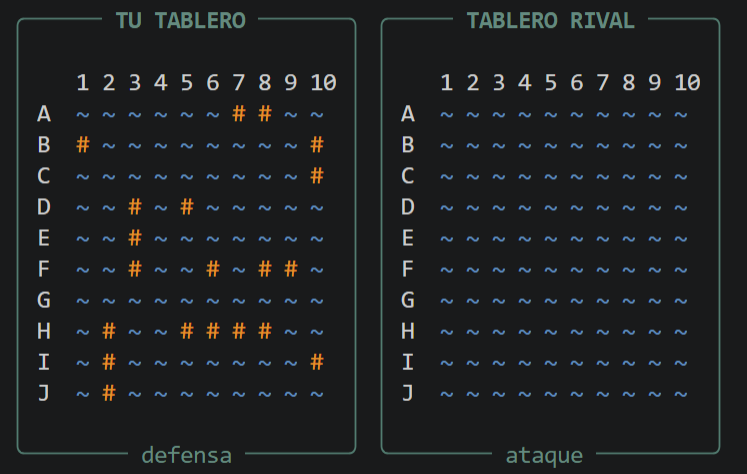
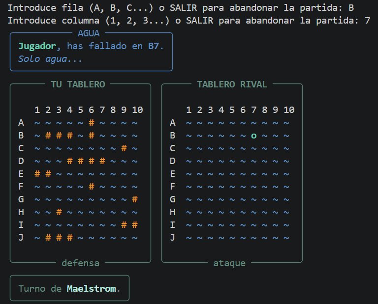

# Hundir la Flota

Minijuego de **Hundir la Flota** desarrollado en Python para jugar desde la terminal contra un ordenador denominado ***Maelstorm***. La interfaz utiliza [Rich](https://github.com/Textualize/rich) para mostrar mensajes, paneles y tableros con formato y colores.

La partida se desarrolla en una cuadrícula de 10 × 10. Las flotas se colocan automáticamente de forma aleatoria y el objetivo es hundir todos los barcos del rival antes de perder toda la flota propia.

## Índice

- [Características](#características)
- [Reglas del juego](#reglas-del-juego)
- [Requisitos](#requisitos)
- [Instalación y ejecución](#instalación-y-ejecución)
- [Cómo jugar](#cómo-jugar)
- [Flujo de la partida](#flujo-de-la-partida)
- [Estructura del proyecto](#estructura-del-proyecto)
- [Tecnologías utilizadas](#tecnologías-utilizadas)
- [Limitaciones conocidas](#limitaciones-conocidas)
- [Posibles mejoras](#posibles-mejoras)
- [Autora](#autora)

## Características

- Partidas de una persona contra un oponente controlado por el ordenador.
- Tablero de 10 filas (A–J) y 10 columnas (1–10).
- Colocación aleatoria de las flotas, evitando que los barcos se toquen entre sí.
- Selección de coordenadas para disparar.
- Detección de disparos repetidos y mensajes cuando las coordenadas no son válidas.
- Registro de impactos, fallos y barcos hundidos.
- El turno continúa después de un impacto; un disparo al agua hace que pase al otro participante.
- Marcado automático de las casillas de agua adyacentes a un barco hundido en el tablero de ataque.
- Mensajes de victoria, derrota y abandono.
- Interfaz de terminal con paneles y colores mediante Rich.

## Reglas del juego

### Tablero y flota

Cada participante dispone de un tablero de 10 × 10. Las filas se identifican con letras de la **A a la J** y las columnas con números del **1 al 10**.

Cada flota contiene 10 barcos, que ocupan 20 casillas en total:

| Tipo de barco | Longitud | Cantidad |
|---|---:|---:|
| Barco grande | 4 casillas | 1 |
| Barco mediano | 3 casillas | 2 |
| Barco pequeño | 2 casillas | 3 |
| Barco de una casilla | 1 casilla | 4 |

Los barcos se colocan automáticamente en horizontal o vertical. No pueden salirse del tablero, ocupar una casilla ya ocupada ni tocarse entre sí, tampoco en diagonal.

### Resultado de los disparos

| Símbolo | Significado |
|---|---|
| `~` | Agua sin disparar |
| `#` | Barco en el tablero de defensa |
| `o` | Disparo fallido o agua |
| `x` | Impacto en un barco |

El objetivo es hundir todos los barcos enemigos. Cuando un disparo impacta en un barco, el participante conserva el turno. Si dispara al agua, el turno pasa al rival. La partida termina cuando uno de los dos participantes pierde todas las casillas de su flota.

## Requisitos

- **Python 3.8 o superior** recomendado.
- **pip**, el instalador de paquetes de Python, para instalar la dependencia externa.
- Una terminal o consola: Terminal, PowerShell, Símbolo del sistema, o la terminal integrada de un editor como Visual Studio Code.
- La biblioteca **Rich**, que se instalará en los pasos siguientes.

No es necesario instalar un IDE para ejecutar el juego. Si Python ya está instalado, no hace falta volver a instalarlo.

### Comprobar si Python está instalado

Abre una terminal y ejecuta uno de estos comandos:

```bash
python --version
```

En algunos sistemas puede ser necesario usar:

```bash
python3 --version
```

Si el comando no muestra una versión de Python 3, instala Python desde [python.org](https://www.python.org/downloads/). En Windows, durante la instalación, activa la opción **Add Python to PATH** si aparece.

## Instalación y ejecución

### 1. Descargar el proyecto

Puedes descargar el repositorio desde GitHub mediante **Code → Download ZIP** y descomprimirlo, o clonarlo con Git:

```bash
git clone <URL-DEL-REPOSITORIO>
cd <NOMBRE-DEL-REPOSITORIO>
```

Sustituye los valores entre `< >` por la URL y el nombre reales del repositorio. Para clonar mediante Git, necesitas tener [Git](https://git-scm.com/downloads) instalado; si descargas el ZIP, no es necesario.

### 2. Crear un entorno virtual (recomendado)

Un entorno virtual mantiene las dependencias del proyecto separadas de las del resto del sistema.

**Windows (PowerShell o CMD):**

```bash
python -m venv .venv
.venv\Scripts\activate
```

**macOS o Linux:**

```bash
python3 -m venv .venv
source .venv/bin/activate
```

Cuando esté activado, normalmente aparecerá `(.venv)` al principio de la línea de la terminal.

### 3. Instalar la dependencia

Con el entorno virtual activado, ejecuta:

```bash
python -m pip install --upgrade pip
py -m pip install -r requirements.txt
```

Si en macOS o Linux tu instalación utiliza `python3`, puedes sustituir `python` por `python3` en los comandos correspondientes.

### 4. Iniciar el juego

Desde la carpeta donde se encuentra `main.py`, ejecuta:

```bash
python main.py
```

En sistemas donde se use `python3`:

```bash
python3 main.py
```

El juego mostrará las instrucciones y esperará a que pulses **Enter** para comenzar.

## Cómo jugar

1. Lee las instrucciones iniciales y pulsa **Enter**.
2. Escribe el nombre con el que quieres jugar.
3. El programa coloca automáticamente tu flota y la del ordenador y empieza con tu turno.

  <p align: "center"></img></p>
  
4. Cuando sea tu turno, introduce la fila de la casilla que quieras atacar (por ejemplo, `B`) y después la columna (por ejemplo, `7`). La coordenada completa sería **B7**.
5. Si el disparo alcanza un barco, se registra un impacto. Si alcanza la última casilla pendiente de ese barco, se anuncia que ha sido hundido.
6. Si el disparo cae al agua, se registra el fallo y pasa el turno al ordenador.

  <p align: "center"></img></p>

7. Continúa hasta hundir la flota rival o perder la tuya.

Para abandonar, escribe `SALIR` cuando el programa solicite la fila o la columna.

**Importante:** introduce la fila como una letra entre `A` y `J` y la columna como un número entre `1` y `10`. No repitas una coordenada en la que ya hayas disparado.

## Flujo de la partida

El programa sigue esta secuencia general:

```text
Inicio
  ↓
Mostrar instrucciones y solicitar nombre
  ↓
Crear jugador y ordenador
  ↓
Colocar aleatoriamente ambas flotas
  ↓
Alternar turnos y solicitar/producir un disparo
  ↓
Validar coordenadas y comprobar el resultado
  ↓
Actualizar tableros y mostrar el resultado
  ↓
¿Quedan barcos a ambos participantes?
  ├── Sí → continuar la partida
  └── No → mostrar victoria o derrota y terminar
```

La lógica está separada en módulos: `main.py` coordina la partida, `clases.py` contiene los tableros y participantes, `funciones.py` reúne funciones auxiliares y `variables.py` centraliza las constantes del juego.

## Estructura del proyecto

```text
hundir-la-flota/
├── main.py           # Punto de entrada: inicio, turnos, interfaz y final de partida
├── clases.py         # Clases Tablero, Jugador y Ordenador
├── funciones.py      # Instrucciones y evaluación de impactos/fallos
├── variables.py      # Tamaño del tablero, flota, estados, símbolos y colores
├── requirements.txt  # Requerimientos (bibliotecas externas necesarias)
└── README.md         # Documentación del proyecto
```

### Responsabilidad de cada archivo

- **`main.py`**: inicia el juego, crea a los participantes, coloca las flotas, gestiona los turnos, muestra los tableros y anuncia el resultado.
- **`clases.py`**: implementa `Tablero`, `Jugador` y `Ordenador`. Gestiona la colocación de barcos, los disparos, los impactos, los fallos y el estado de cada participante.
- **`funciones.py`**: contiene `instrucciones()` para mostrar las reglas y `tocado_o_hundido()` para determinar si un disparo ha tocado un barco, lo ha hundido o ha fallado.
- **`variables.py`**: centraliza constantes como el tamaño del tablero, la longitud y cantidad de barcos, los estados de las casillas, los símbolos, las orientaciones y los colores de la interfaz.

## Tecnologías utilizadas

- **Python**: lógica y estructura del juego.
- **Rich**: presentación de texto coloreado, paneles y columnas en la terminal.
- **Git y GitHub** (opcionales para ejecutar): control de versiones y alojamiento del código.

## Limitaciones conocidas

- La colocación de barcos y los disparos del ordenador son aleatorios; no hay una estrategia de inteligencia artificial avanzada.
- La interfaz depende de una terminal compatible con los formatos de Rich.

## Posibles mejoras

- Añadir pruebas automatizadas para la colocación de barcos, validación de coordenadas y resolución de disparos.
- Mejorar la estrategia de disparo del ordenador.

## Autora

Proyecto desarrollado por **Alexandra Dodu**.

---

Si encuentras un error o quieres proponer una mejora, puedes abrir una *issue* en el repositorio de GitHub.
