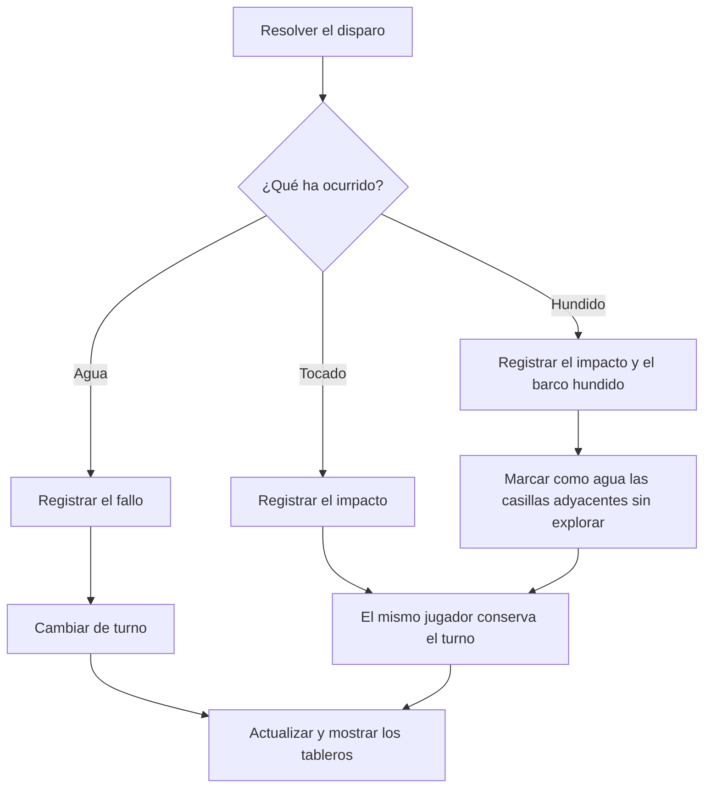
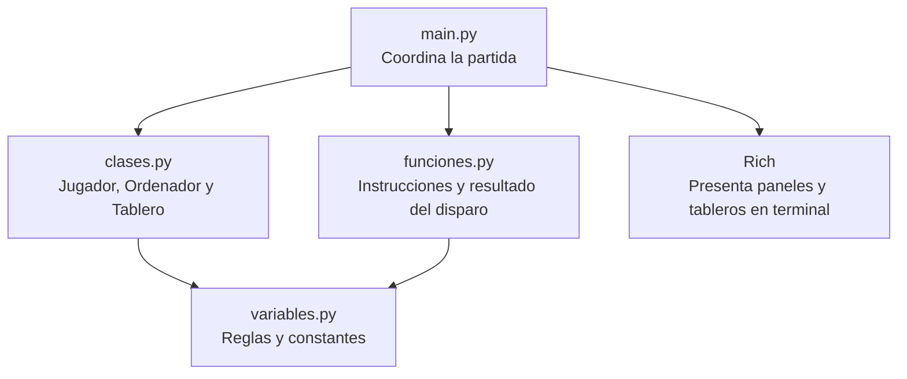
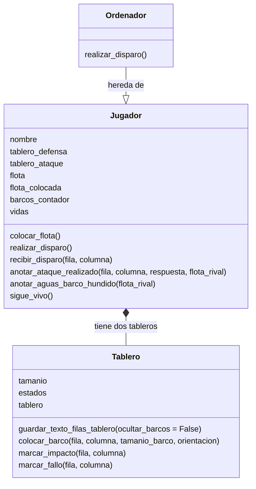
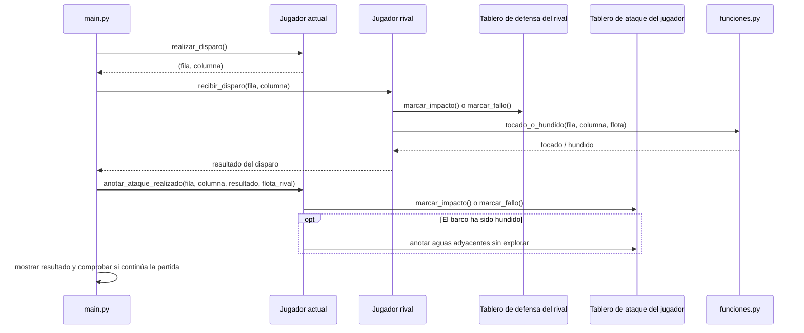

# Diagrama de flujo funcional — Hundir la Flota

## 1. Inicio y preparación de la partida

En primer lugar, se muestran las instrucciones, se crean los jugadores y se preparan los tableros con sus flotas.

## 2. Selección del turno y del disparo

Cuando la partida está preparada, se comprueba si quedan barcos a flote y se determina quién debe disparar.

## 3. Resolución del disparo

El resultado del disparo determina qué se registra en el tablero y si el jugador conserva el turno.

## 4. Comprobación del final de la partida

Después de cada disparo se vuelven a mostrar los tableros y se comprueba si alguna flota ha sido destruida.

## 5. Flujo principal completo

## 6. Cómo se reparten las responsabilidades en el código
### 6.1. Vista general de los archivos

- **`main.py`**: pone en marcha el juego, crea los participantes, organiza los turnos y decide cuándo termina la partida.
- **`clases.py`**: contiene los objetos que representan el tablero y a los participantes.
- **`funciones.py`**: contiene funciones auxiliares que no pertenecen a una clase concreta, como mostrar las instrucciones y determinar si un barco ha sido tocado o hundido.
- **`variables.py`**: reúne valores compartidos, como el tamaño del tablero, la flota, los símbolos y las orientaciones.
- **`Rich`**: biblioteca externa que mejora la presentación visual de los mensajes en la terminal.

### 6.2. Clases

### 6.3. Cómo colaboran los objetos durante un disparo

