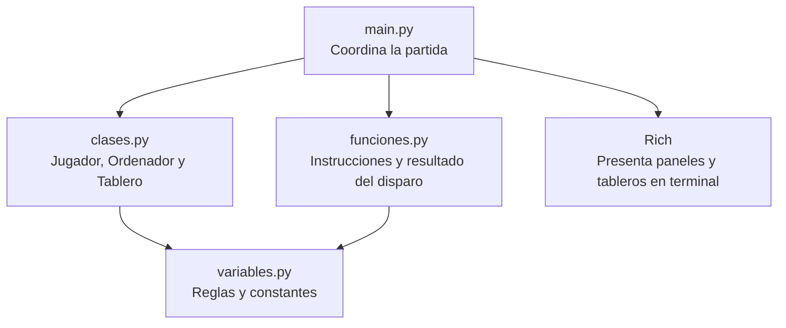
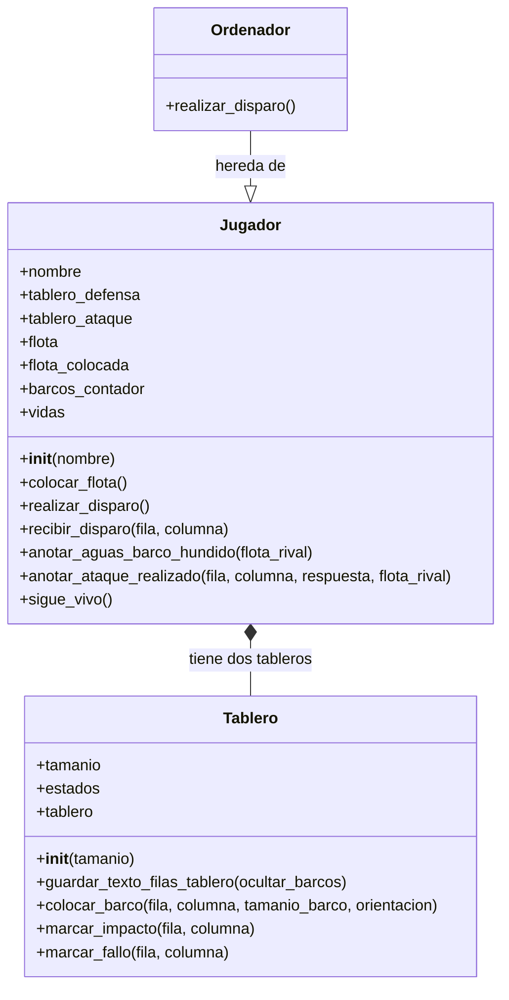
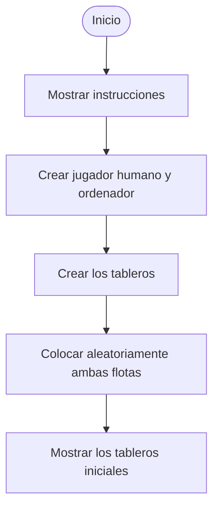
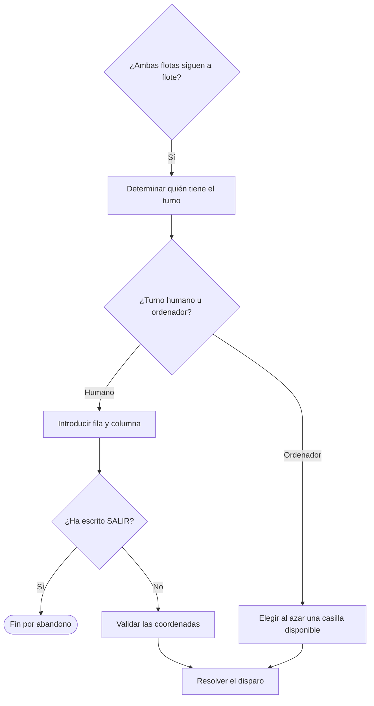
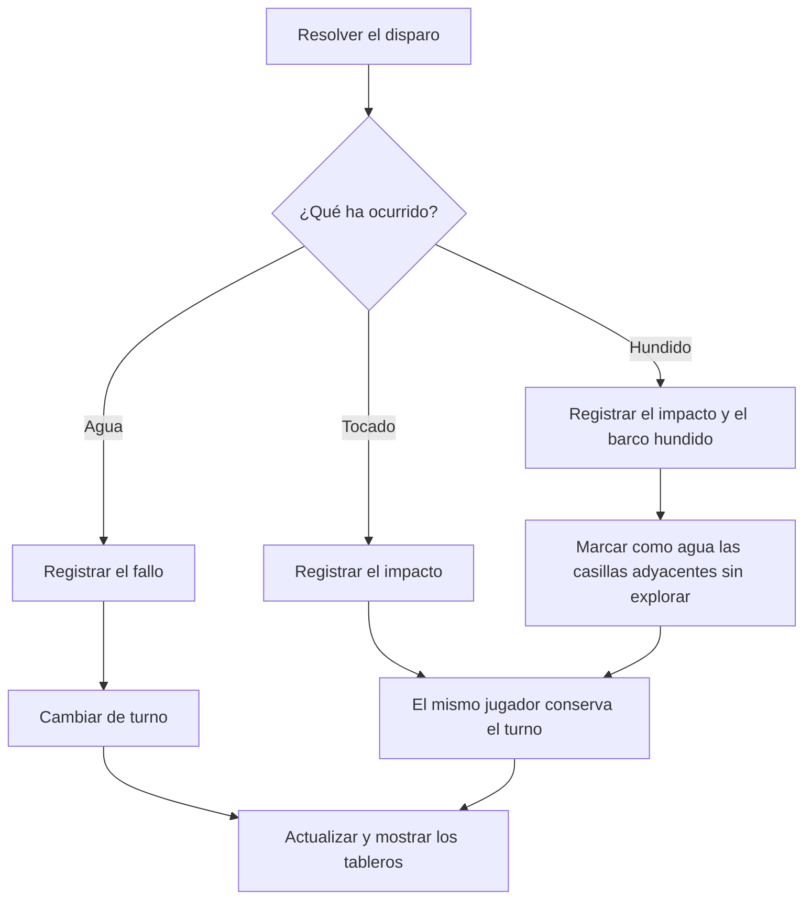
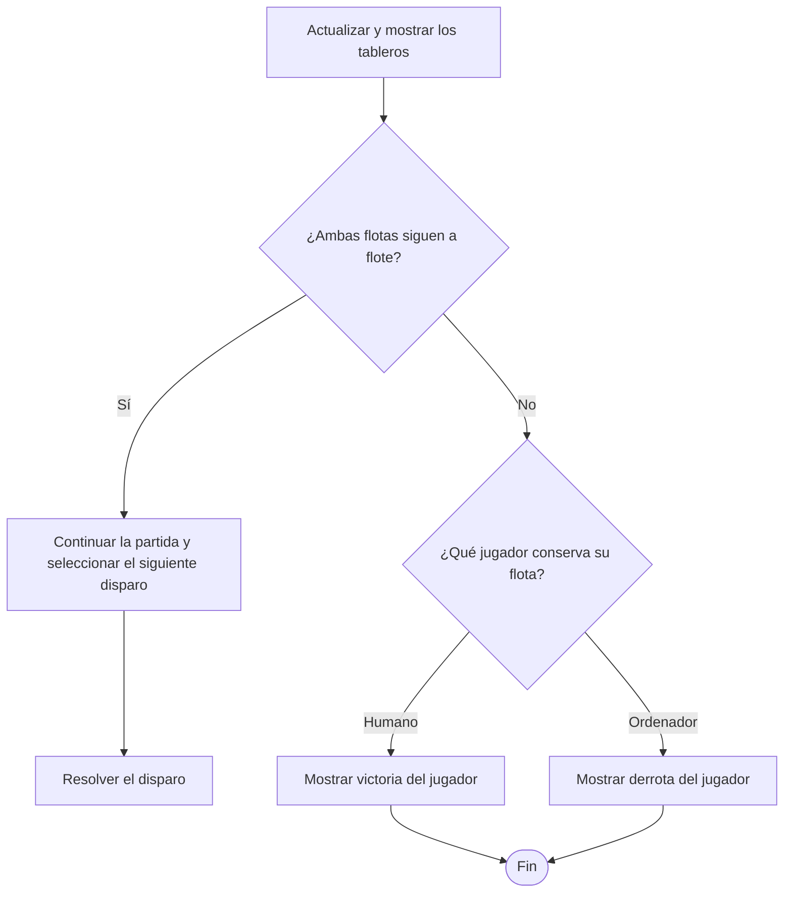
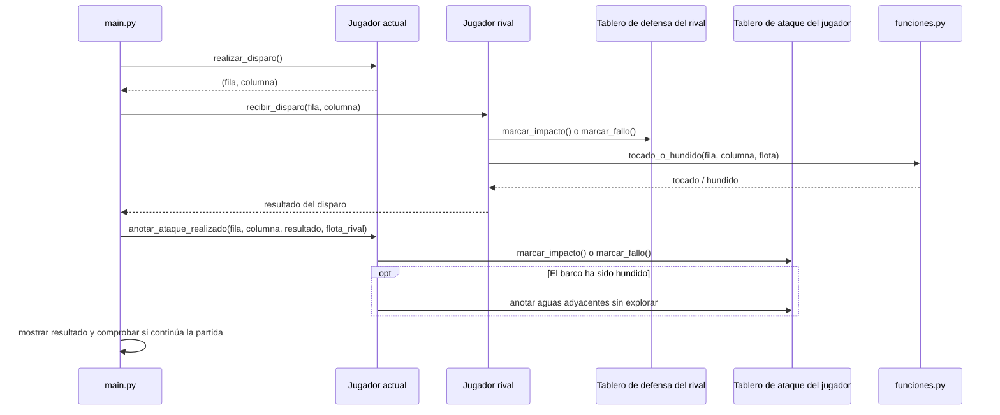
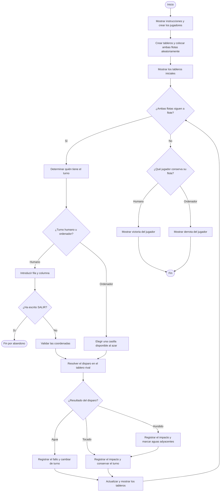

# Diagrama de flujo funcional — Hundir la Flota

## 5. Cómo se reparten las responsabilidades en el código
### 5.1. Vista general de los archivos

- **`main.py`**: pone en marcha el juego, crea los participantes, organiza los turnos y decide cuándo termina la partida.
- **`clases.py`**: contiene los objetos que representan el tablero y a los participantes.
- **`funciones.py`**: contiene funciones auxiliares que no pertenecen a una clase concreta, como mostrar las instrucciones y determinar si un barco ha sido tocado o hundido.
- **`variables.py`**: reúne valores compartidos, como el tamaño del tablero, la flota, los símbolos y las orientaciones.
- **`Rich`**: biblioteca externa que mejora la presentación visual de los mensajes en la terminal.

### 5.2. Clases y herencia: quién hereda de quién

Una **clase** es como un plano que define qué datos y acciones tendrá un objeto. Por ejemplo, `Jugador` define los datos y acciones comunes a quienes juegan.

La **herencia** permite crear una clase nueva a partir de otra. En este juego, `Ordenador` hereda de `Jugador`: por eso tiene sus tableros, su flota y sus métodos, pero cambia la forma de elegir un disparo.

## 1. Inicio y preparación de la partida

En primer lugar, se muestran las instrucciones, se crean los jugadores y se preparan los tableros con sus flotas.

## 2. Selección del turno y del disparo

Cuando la partida está preparada, se comprueba si quedan barcos a flote y se determina quién debe disparar.

## 3. Resolución del disparo

El resultado del disparo determina qué se registra en el tablero y si el jugador conserva el turno.

## 4. Comprobación del final de la partida

Después de cada disparo se vuelven a mostrar los tableros y se comprueba si alguna flota ha sido destruida.

### 5.3. Clase `Tablero`: representa una cuadrícula

Cada objeto `Tablero` guarda una cuadrícula y sabe mostrarla, colocar barcos y marcar los resultados de los disparos.

**Atributos principales**

| Atributo | Para qué sirve |
|---|---|
| `tamanio` | Número de filas y columnas. Si no se indica otro valor, usa `TAMANIO_TABLERO` de `variables.py`. |
| `estados` | Relaciona cada estado interno (`agua`, `barco`, `fallo`, `impacto`) con el símbolo que se muestra. |
| `tablero` | Lista de listas que representa las celdas de la cuadrícula. |

**Métodos**

| Método | Argumentos | Qué hace y qué devuelve |
|---|---|---|
| `__init__(tamanio=var.TAMANIO_TABLERO)` | `tamanio`: dimensión del tablero; es opcional. | Crea los atributos y llena todas las celdas con agua. |
| `guardar_texto_filas_tablero(ocultar_barcos=False)` | `ocultar_barcos`: opcional; si es `True`, muestra los barcos como agua. | Devuelve el tablero como texto para poder mostrarlo. |
| `colocar_barco(fila, columna, tamanio_barco, orientacion)` | Fila y columna iniciales, longitud del barco y dirección (`N`, `S`, `E`, `O` o `None` para una casilla). | Comprueba que el barco cabe y no se solapa ni queda junto a otro. Devuelve las coordenadas colocadas si tiene éxito o `False` si no puede colocarlo. |
| `marcar_impacto(fila, columna)` | Fila en letra y columna en número. | Marca la casilla como impacto. Devuelve `True` si las coordenadas son válidas y `False` si no lo son. |
| `marcar_fallo(fila, columna)` | Fila en letra y columna en número. | Marca la casilla como fallo. Devuelve `True` si las coordenadas son válidas y `False` si no lo son. |

### 5.4. Clase `Jugador`: datos y acciones de cada participante

Cuando se crea un jugador, se le asignan un nombre, dos tableros, una flota y un número de vidas equivalente al total de casillas ocupadas por sus barcos.

**Atributos principales**

| Atributo | Para qué sirve |
|---|---|
| `nombre` | Nombre del participante. |
| `tablero_defensa` | Su propio tablero, donde se colocan los barcos y se reciben los disparos. |
| `tablero_ataque` | Tablero donde registra los disparos que realiza contra el rival. |
| `flota` | Cantidad de barcos de cada longitud que debe colocar. |
| `flota_colocada` | Guarda las coordenadas y las vidas restantes de cada barco colocado. |
| `barcos_contador` | Cuenta cuántos barcos se han colocado para identificarlos. |
| `vidas` | Casillas de barco que aún no han recibido impacto; llega a cero cuando pierde toda la flota. |

**Métodos**

| Método | Argumentos | Qué hace y qué devuelve |
|---|---|---|
| `__init__(nombre)` | `nombre`: nombre del jugador. | Prepara sus atributos, sus dos tableros, la flota y las vidas iniciales. |
| `colocar_flota()` | Ninguno. | Coloca aleatoriamente todos sus barcos en `tablero_defensa`. Repite el intento si una posición no es válida. |
| `realizar_disparo()` | Ninguno. | En el jugador humano, pide fila y columna, valida la entrada y evita repetir disparos. Devuelve `(fila, columna)` o `None` si se escribe `SALIR`. |
| `recibir_disparo(fila, columna)` | Coordenadas del disparo rival. | Actualiza su tablero de defensa y sus vidas si recibe un impacto. Devuelve `tocado`, `hundido` o `fallo`. |
| `anotar_aguas_barco_hundido(flota_rival)` | `flota_rival`: información de los barcos del oponente. | Marca como fallos las casillas adyacentes a barcos hundidos que todavía estaban sin explorar. |
| `anotar_ataque_realizado(fila, columna, respuesta, flota_rival)` | Coordenadas del disparo, resultado y flota del rival. | Registra el disparo en `tablero_ataque`; si hundió un barco, también anota las aguas adyacentes. |
| `sigue_vivo()` | Ninguno. | Devuelve `True` si conserva vidas y `False` si su flota ha sido destruida. |

### 5.5. Clase `Ordenador`: un jugador con disparos automáticos

`Ordenador` es una subclase de `Jugador`. Por tanto, **no necesita volver a definir** métodos como `colocar_flota()`, `recibir_disparo()` o `sigue_vivo()`: los hereda de `Jugador`.

Su método propio `realizar_disparo()` funciona de otra manera:

| Método | Argumentos | Qué hace y qué devuelve |
|---|---|---|
| `realizar_disparo()` | Ninguno. | Escoge al azar una casilla en la que todavía no haya disparado. Devuelve las coordenadas como `(fila, columna)`, convirtiendo la fila a letra y la columna a número. |

Esto es un ejemplo de **sobrescritura de métodos**: las dos clases tienen un método llamado `realizar_disparo()`, pero cada una lo resuelve de forma distinta. El jugador introduce las coordenadas; el ordenador las genera al azar.

### 5.6. Funciones auxiliares de `funciones.py`

Estas funciones no son métodos de las clases: se llaman directamente desde el módulo `funciones`.

| Función | Argumentos | Qué hace y qué devuelve |
|---|---|---|
| `instrucciones()` | Ninguno. | Muestra el objetivo, el tablero, la flota y las reglas antes de empezar. |
| `tocado_o_hundido(fila, columna, flota)` | Fila y columna del impacto; `flota`, diccionario con las coordenadas y las vidas de cada barco. | Localiza el barco alcanzado, reduce sus vidas y devuelve `tocado` o `hundido`. Si las coordenadas no corresponden a ningún barco, devuelve `fallo`. |

### 5.7. Cómo colaboran los objetos durante un disparo

Este esquema muestra el recorrido de la información cuando el jugador o el ordenador dispara. `main.py` coordina las llamadas; cada objeto se ocupa de su parte.

**Ejemplo sencillo:** si el jugador dispara a `B4`, `main.py` pasa esas coordenadas al rival. El rival consulta su tablero de defensa y registra si ha sido agua o impacto. Si ha acertado a un barco, `tocado_o_hundido()` comprueba cuántas casillas le quedan. Después, el jugador que disparó anota el resultado en su tablero de ataque.

**Importante sobre los argumentos:** los nombres dentro de los paréntesis indican qué información necesita un método. Por ejemplo, `recibir_disparo(fila, columna)` necesita las dos coordenadas; `sigue_vivo()` no necesita argumentos adicionales. `self` no cuenta como argumento que debas escribir en la llamada.

## 6. Reglas clave

- **Colocación de flotas:** los barcos se sitúan aleatoriamente y no deben solaparse ni tocar otros barcos.
- **Agua:** el disparo falla y el turno pasa al otro jugador.
- **Tocado:** el disparo acierta, pero el barco conserva alguna casilla; el mismo jugador vuelve a disparar.
- **Hundido:** se destruye el barco, se marcan como agua las casillas adyacentes que aún estaban sin explorar y el mismo jugador conserva el turno.
- **Fin de partida:** gana quien consigue hundir toda la flota rival. La persona también puede abandonar escribiendo `SALIR` cuando se le solicitan las coordenadas.

## 7. Flujo principal completo

Este último diagrama reúne las etapas anteriores en una sola vista, desde el inicio hasta el resultado de la partida.

## Símbolos del tablero

| Símbolo | Significado |
|---|---|
| `~` | Agua sin explorar |
| `#` | Barco propio |
| `o` | Disparo fallido o agua marcada automáticamente |
| `x` | Impacto en un barco |
